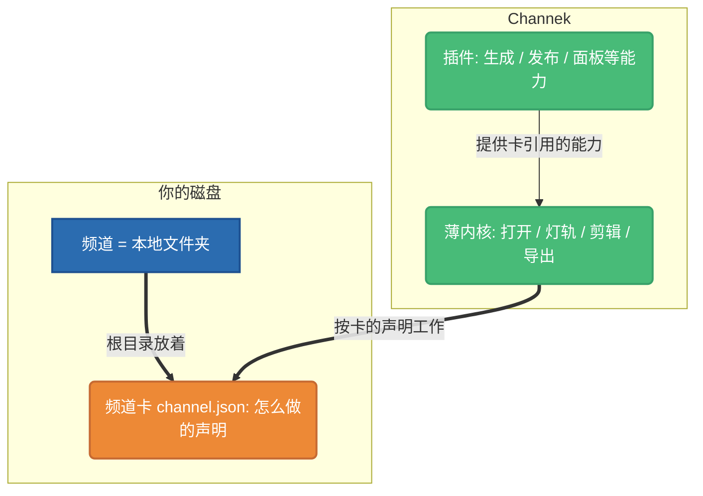

# Channek 是什么

**Channek 是一个创作管理 App**:打开你电脑上的一个文件夹,把里面的创作从想法一路管到发布——

- **看得见**:每条内容做到哪一步、缺什么件,在一条诚实的进度轨上摊开,不靠你记;
- **进得去**:内容详情、素材、剪辑台在同一个窗口里连着,不用在文件管理器和剪辑软件之间来回跳;
- **发得出**:导出与发布是流程的最后一站,不是另一套工具。

而「这类创作怎么做」写在频道根目录一份**可复制、可分发的频道卡** `channel.json` 里——换一张卡,就换一套工作方式。

## 三个核心概念

| 概念 | 一句话 |
|---|---|
| **工作区 / 频道** | 磁盘上的一个文件夹。根目录有一份频道卡 `channel.json` 的文件夹叫**频道**;普通文件夹也能打开,当文件工作台用。 |
| **频道卡** | 这个频道「怎么做」的纯数据声明:目录结构、出片流程、品牌与音色、需要哪些能力。可打包成 `.channekcard` 分发——分享的是做法,不是你的作品。 |
| **插件** | 真正干活的能力:生成素材、转码、发布平台、界面面板……卡只声明「要什么」,插件负责「怎么做」。 |

## 它不是什么

- **不是「AI 一键出片」按钮**——内容的执行主体可以是内置助手 Yan,也可以是你自己的 AI Agent;它们都按卡声明的流程干活,产物是你看得见摸得着的普通文件。
- **不是云端 SaaS**——频道就是你磁盘上的文件夹,app 只是把它当工作区打开;数据格式公开,随时可迁出。
- **不接管你的文件**——给已有文件夹套一张卡不会改动现有文件,只在根目录写一份 `channel.json`、按卡的声明补齐缺的目录。

## 从哪开始

- 想直接用:从[安装与首次打开](/docs/guide/getting-started/install)开始。
- 想给自己的频道写一张卡:去[频道卡开发](/docs/style-card/overview)。
- 想给 Channek 加能力:去[插件开发](/docs/plugin/overview)。
