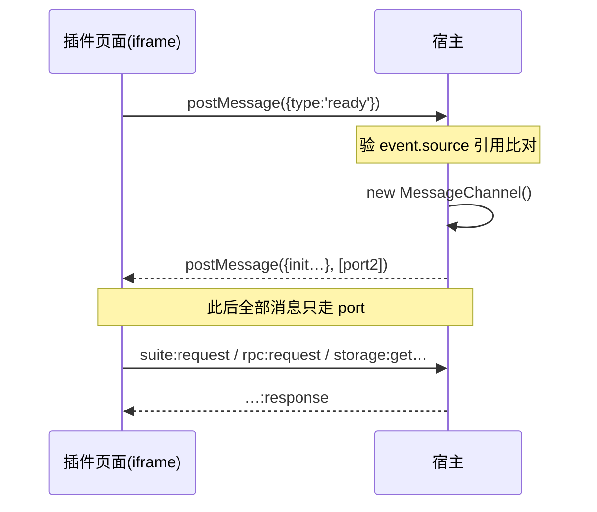

# 运行时原理

一句话:**T1 是一个被关起来的网页,T2 是一个没有界面的后台进程。** 它们之间、以及它们与 app 之间,只能靠**传消息**说话——不共享代码,也不共享内存。

## 两种形态,各住哪里

| | T1 `sandboxed` | T2 `privileged` |
|---|---|---|
| 载体 | **iframe**(一个网页) | **独立 Node 进程**(Extension Host) |
| 有 DOM 吗 | ✅ | ❌ |
| 有 fs / spawn 吗 | ❌ | ✅ |
| 用户看得见吗 | ✅ 就是界面 | ❌ 永远看不见 |
| manifest 入口 | `entries.sandbox` → `.html` | `entries.main` → `.cjs` |

## T1:为什么必须过桥

你的页面 origin 是 `plugin://<你的插件id>`——**每个插件一个**,与宿主主文档不同源,插件之间也互相隔离。同源策略保证 `parent.document` 碰不到、`frameElement` 恒为 `null`;而 `localStorage` / `IndexedDB` / `Cache` **原生可用**(它们是任何前端页面的地板,不是危险 API)。

跨源窗口之间浏览器只留一条数据通道:`postMessage`。宿主在初始化时把一个 **MessagePort** 实物递给你的页面,此后所有通信只走这个端口——端口是对象引用,没有全局注册表、无法按名查找,持有引用本身就是权限。

握手流程(SDK 已封装,理解即可):



三条数据链路:

1. **suite 桥白名单 op**(宿主解释 payload):读素材概览、内容条目、运营台账、导航、剪贴板、受控写。这是纯 T1 插件的主数据面,全部 op 见[参考表](/docs/reference/suite-bridge-ops)。
2. **rpc**(宿主只搬运不解释):路由**恒定为同插件的 T2 host**——跨插件调用不存在,纯 T1 插件调 rpc 恒失败。T2 侧用 `ctx.registerSandboxRequest(method, handler)` 应答,用 `ctx.sandbox.emit(method, payload)` 反向推流。
3. **storage**:代理到插件存储(机器级或频道级,每桶 5MB 配额)。

限额要点:单条请求 ≤256KB(suite 读应答放宽到 1MB)、每插件每分钟 120 条;**大数据不走桥**——媒体用应答里的 `channek-media:` 能力 URL 直接 ``/`<video>` 加载,大清单走「T2 侧持有 + rpc 分页」。超限一律明确报错,不静默丢。

:::warning 最具迷惑性的坑:脚本不能内联
沙箱文档的 CSP 是 `script-src plugin://<id>`,**不含 `'unsafe-inline'`**。写成 `<script>…</script>` 内联的后果是:HTML 与 CSS 照常渲染、只有脚本一行不跑,看起来像「宿主没发 init」。js / css 必须是外部文件,且全部自包含(无外部 CDN)。
:::

### 用 SDK

```bash
npm i @channek/sandbox-sdk     # Apache-2.0 · 零依赖 · 打进你自己的 bundle
```

```ts
import { createSandboxSdk, suiteContextFromInit } from '@channek/sandbox-sdk';

const sdk = createSandboxSdk();
sdk.onInit(async init => {
  const context = suiteContextFromInit(init);        // suite 承载面才非 null
  const overview = await sdk.suite.assetsOverview(); // 走白名单 op
});
```

SDK 是构建期依赖,必须打进你的 bundle(沙箱 CSP 挡掉一切外部源)。**线协议才是唯一契约**,SDK 只是把 requestId 配对、握手、主题 token 注入这些样板封装掉。宿主经 init 与 `theme:changed` 下发主题 token,页面样式一律用 `--ck-*` 变量,别写死颜色。

## T2:入口模块契约

`entries.main` 指向一个 **CJS 单文件 bundle**(建议 esbuild `format: 'cjs'` 全量打包):

```js
// dist/main.cjs
exports.activate = (ctx) => {
  ctx.subscriptions.add(
    ctx.registerCommand('acme.demo.hello', async (arg, context) => {
      // context.workspaceRoot 是宿主盖的频道章,见「多频道」
      return (await ctx.workspace.readText('note.md', { workspaceRoot: context.workspaceRoot })).length;
    })
  );
  return { version: 1 };   // 返回值 = exports,被依赖的插件可取
};
exports.deactivate = () => {};
```

`ctx` 的主要 API(逐条过权限门):

```ts
ctx.workspace.list / readText / writeText / watch   // workspace:read|write;.channek 恒不可写
ctx.project.getSnapshot / apply(tx)                 // 改工程的唯一路径:提议 EditTransaction
ctx.commands.register / execute                     // register 只收 manifest 声明过的 id
ctx.registerSandboxRequest(method, handler)         // 应答自己 T1 页面的 rpc
ctx.net.fetch                                       // 按 manifest 声明的 host 白名单,重定向逐跳复验
ctx.storage.get / set                               // 机器级或频道级
ctx.ui.showNotice / showQuickPick / showOpenDialog / withProgress
ctx.shell.openExternal                              // 仅 http/https
```

运维语义:激活超时 10 秒;连续 3 次激活失败或未捕获异常会**熔断停用**(红标,可手动重试);host 崩溃退避重启。`onUpdate(from, to, ctx)` 在版本变化时先于 `activate` 调一次,做存储与设置迁移。

## 常见误解

| 误解 | 事实 |
|---|---|
| T2 也是 iframe | T2 是没有 DOM 的 Node 进程 |
| T2 插件的页面有特权 | 页面照样是沙箱 iframe,特权只在进程侧 |
| 沙箱 iframe 不能用 GPU | `allow-scripts` 下照样能开 WebGPU / WebCodecs、渲自己的 canvas |
| 桥可以搬大数据 | 单条 256KB(读应答 1MB),大数据走能力 URL 或 T2 分页 |
| 可以调别的插件的 rpc | 路由锁死同插件;跨插件协作走 `capability:invoke` |
| 用 SDK 就依赖了内核 | SDK 打进你的 bundle,双方只共享协议不共享代码 |
