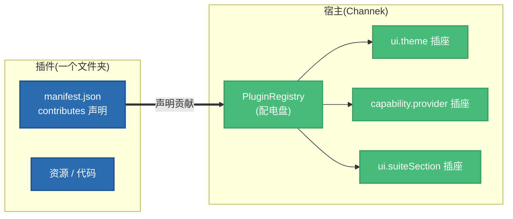

# 插件开发总览

:::tip 用 AI 助手开发?
装上[官方 agent skills](/docs/guide/ecosystem/develop),对你的 Claude Code / Codex 说「我想给 Channek 加个 XX 功能」,它会替你选形态、写 manifest、实现并教你调试——本册的契约它都懂。
:::

Channek 的架构可以用一句话说完:**系统是壳子**。内核只守少数几条铁律(工程格式、时间模型、唯一写路径、进程隔离、引擎与 UI 分离、自包含),其余一切可变能力——文件怎么看、图怎么生、片怎么导、频道长什么样——都是**插件贡献**的。装零个插件的 Channek 是一个资源管理器。

所以「给 Channek 加一个功能」的正确形态几乎总是:**找到那个扩展点,贡献一条声明**。

## 心智模型

**扩展点是插座,manifest 是说明书,registry 是配电盘,loader 是安检门——安检门分三级信任。**

三个要点:

- **贡献 = 声明(decl)+ 可选实现(impl)**。声明是纯数据写在 manifest 里;实现是代码,只有 T1/T2 插件才有。
- **信任三级**:T0 声明级(纯 JSON/SVG/字体,零代码)→ T1 沙箱级(UI 代码跑在隔离 iframe)→ T2 特权级(逻辑代码跑在独立进程,等同完全本机信任)。详见[信任分级](./concepts/trust-tiers.md)。
- **第一方无特权**:内置插件与你放进 `~/.channek/plugins/` 的第三方插件走完全同一条校验、注册、启停路径。

## 我要做 X,去哪个扩展点

| 我要做的 | 去哪 | 状态 |
|---|---|---|
| 一条**能力**(出图 / 配音 / 转写 / 发布…),能被卡与命令行调用 | [`capability.provider`](./contributions/capability.md) | ✅ |
| 一个配色**主题** / 一套文件**图标** | [`ui.theme` / `ui.iconTheme`](./contributions/ui-basics.md) | ✅ |
| 一条**命令**、右键菜单项、快捷键 | [`ui.command` 系](./contributions/ui-basics.md) | ✅ |
| 一种文件的**查看器 / 编辑器** | [`ui.fileViewer`](./contributions/viewers-panels.md) | ✅ |
| 一整页**功能区界面**(挂进侧栏的那种) | [`ui.suiteSection`](./contributions/suite-section.md) | ✅ |
| 出片流程里的**一步**(工作台面 + 自动化面) | [`ui.contentStep` / `production.step`](./contributions/content-production.md) | 部分 ✅ |
| **生成器 / 烘焙器 / 导出预设 / 媒体探测** | [`generation.*` / `media.*`](./contributions/media-publish.md) | 部分 ✅ |
| **发布平台**对接 | [`publish.platform`](./contributions/media-publish.md) | ✅ |
| **AI 工具 / 宏 / 受托执行** | [`ai.*`](./contributions/ai.md) | 路线图为主 |
| **剪辑台**面板 / 检查器 / 素材源 | [`editor.*`](./contributions/editor.md) | 路线图 |
| 携带一张**频道卡模板** / 工件类型 / 目录布局 | [`workspace.*`](./contributions/content-production.md) | 部分 ✅ |

全部 40 个贡献键的速查表见[参考 · 贡献键全表](/docs/reference/contribution-keys)。

## 三条最容易被违反的规矩

:::warning 先记住这三条

1. **不许维护平行时间轴。** 插件改剪辑工程只能**提议** `EditTransaction`,永不直接写 `.channek` 工程文件。
2. **不许假设当前频道。** 一个 app 可以同时开多个频道窗口,而 T2 插件全 app 只有一份实例。频道身份由**调用带来**,不许读「最后挂上的那个」。见[多频道与作用域](./concepts/channels.md)。
3. **不许把「我不知道」报成绿灯。** 前置探测三态里 `unknown` 永远不能折叠进 `ready`。见[就绪度](./concepts/readiness.md)。

:::

## 从哪读起

第一次来,按这个顺序读,两小时能写出第一个能跑的插件:

1. [快速上手](./getting-started/environment.md)——环境、发现目录、五分钟写一个主题插件
2. [信任分级](./concepts/trust-tiers.md)——T0/T1/T2 该选哪级
3. [运行时原理](./concepts/runtime.md)——你的代码跑在哪、为什么要过桥
4. [能力体系](./contributions/capability.md)——今天最常见的插件形态
5. [打包与分发](./distribution/packaging.md)——把插件发出去
