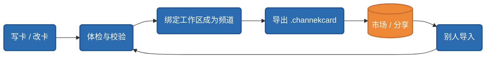

# 卡的生命周期

## 卡落到一个目录上的两条路

**频道 = 工作区 × 卡**。让一张卡和一个本地文件夹发生关系,有且只有两条路:

| 路径 | 语义 | 场景 |
|---|---|---|
| **从卡新建频道** | 先有卡,按卡声明的目录布局**造一个新文件夹** | 从模板/市场拿到一张卡,开一个新频道 |
| **把卡应用到文件夹** | 先有文件夹,**后绑卡** | 已经在用的素材目录想升级成频道 |

第二条路的语义是**对齐而不是重建**:缺的目录补上、已有的内容不碰;已经绑过卡的文件夹会拒绝再应用第二张卡。

绑定关系记在工作区根的 `.channek/workspace.json` 标记里(卡目录的相对路径)——**一个目录是不是频道,由目录自证**,不依赖软件的全局注册表。这也是频道文件夹可以整体拷走、换机器打开仍然成立的原因。

## 卡库:列表、导入、导出、体检

设置里的「风格卡」组是卡的管理面:

- **列表与激活**——本机所有卡的库存,一个工作区同一时刻绑定一张活动卡;
- **导入**——从 `.channekcard` 包导入,进卡库前过 schema 校验、版本迁移与流程静态体检;
- **导出**——把卡打成可分发的 `.channekcard` 包,导出时自动剥离机器特定字段(见[可移植红线](../distribution/portability.md));
- **体检报告**——依赖是否齐(插件/能力/密钥)、流程声明是否自洽,逐项列出并给引导。

## 版本与迁移

卡格式有版本号(当前 `formatVersion: 2`)。旧版本的卡在加载时**逐级自动迁移**,不需要作者手动改写。协议**只增不改**:新字段永远是可选追加,已发布字段不改名、不变义——所以今天写的卡,不会被明天的软件版本弄坏。

