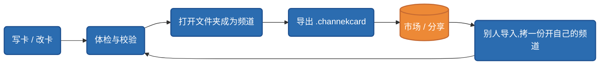

# 卡的生命周期

## 一个文件夹变成频道的三条路

**频道 = 一个文件夹 + 根目录一份频道卡 `channel.json`**。一个文件夹变成频道,有三条路:

| 路径 | 语义 | 场景 |
|---|---|---|
| **用卡开新频道** | 先有卡,**造一个新文件夹**,把卡和做法文件拷进去,根目录写出 `channel.json` | 从模板 / 卡库 / 市场拿到一张卡,开一个新频道 |
| **把卡应用到文件夹** | 先有文件夹,**后套卡**:根目录写出 `channel.json`,按卡的布局补齐缺的目录 | 已经在用的素材目录想升级成频道 |
| **直接打开** | 文件夹根上本来就有 `channel.json`(自己写的、从 git 拉下来的) | 手写的频道、别人用 git 分享的频道 |

第二条路的语义是**对齐而不是重建**:缺的目录补上、已有的内容不碰;根目录已经有频道卡的文件夹会拒绝再套第二张。用卡开频道时,卡里 `questions` 点名的字段(人设、口号这类)会逐题问你——作者的原值当示例,都可以不填。

**一个目录是不是频道,由目录自证**:只看根目录有没有 `channel.json`,不依赖软件的全局注册表。频道在这台机器上的身份(顶层 `id` / `slug`)在首次打开时生成并写回这份卡——可见、入库、随频道走。频道文件夹里的 `.channek/` 只放「这台机器上对这个频道的状态」(启用开关、插件存储、索引缓存),删掉它频道照样能开,只丢本机偏好。这也是频道文件夹可以整体拷走、换机器打开仍然成立的原因。

## 卡库:列表、导入、导出、体检

设置里的「频道卡」组是卡的管理面:

- **卡库**——本机所有卡的库存。卡库留着每张卡的原件,用它开出的频道各自拿一份拷贝,改自己的频道不会动到原件;
- **导入**——从 `.channekcard` 包导入,进卡库前过 schema 校验与流程静态体检;
- **导出**——把频道的做法打成可分发的 `.channekcard` 包,导出时自动剥离机器特定字段、撤下问卷字段的原值(见[可移植红线](../distribution/portability.md)与[打包 .channekcard](../distribution/packaging.md));
- **体检报告**——依赖是否齐(插件/能力/密钥)、流程声明是否自洽,逐项列出并给引导。

## 版本与兼容

卡格式有版本号(`formatVersion: 1`)。早期格式的卡与频道打开时会在内存里自动转换,不需要作者手动改写。协议**只增不改**:新字段永远是可选追加,已发布字段不改名、不变义——所以今天写的卡,不会被明天的软件版本弄坏。

