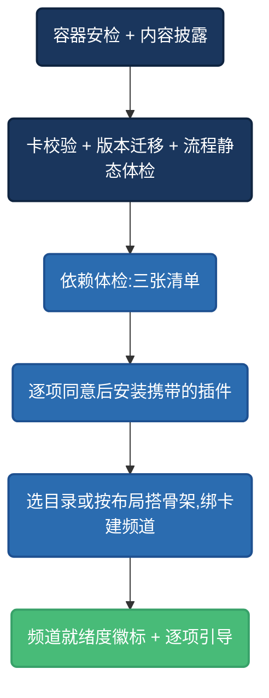

# 导入向导:收卡人看到什么

你在 `requires` / `runtime` / `bundle` 里写的每一条声明,最终都会变成导入向导里的一屏。理解这条链,写声明时才有的放矢。

## 逐步说明

**⓪ 容器安检与披露**——任何解包落盘之前,先过 zip 硬化检查,并在第一屏披露「本包含 N 个可执行插件 · 最高信任级」。你在 `bundle.omit` 里写的 `reason` 也在这里露出:「这块作者没带,要你自己做」。

**① 卡体检**——schema 校验、旧版本逐级迁移、流程静态检查(步序断链、非法 config、引用了未注册的工件 kind)。**卡非法则整包终止,插件一个不装。**

**② 依赖体检:三张清单(不阻塞导入)**——

| 清单 | 从哪推导 | 呈现 |
|---|---|---|
| 缺步骤插件 | `pipeline.steps` 引用的步骤 id + `requires.plugins` | 每项给「装插件」引导 |
| 缺能力 provider | `requires.providers`(偏好链全空才算缺;点名的缺、别家顶得上算「降级」不算缺件) | 区分「缺」与「效果可能不同」 |
| 缺密钥 | provider 的 credentials 声明推导 ∪ `requires.secrets` | 逐条标注是哪条 provider 要的、去设置页哪里填 |

缺件**不阻止导入**——收卡人可以先把频道建起来,再按引导逐项补齐。

**③ 装插件**——组合包携带的插件逐个过信任门与签名校验,用户逐项确认。占位卡上的「安装」按钮走商店索引核验,**绝不按卡内写的 id 直装**(防拼写仿冒)。

**④ 建频道**——选一个目录(或按 `layout` 新建骨架),绑卡,进入频道。

**⑤ 就绪度徽标**——缺件的频道标「未就绪」,每一项都有可执行的引导:装某个插件、去设置页补某把密钥、按 `runtime.endpoints[].setup` 的指引自备某个服务。

## 对写卡人的三条启示

1. **`plugins` 字段决定引导质量**——只写 `prefer` 不写 `plugins`,收卡人看到的是「缺一个 provider」;写了,看到的是「装这个插件」按钮。一字之差,是死胡同与一条路的差别。
2. **`difficulty` 如实标**——`hosted`(填个 key)/ `proxy`(自建服务)/ `model`(自训模型/备素材)三档,标错比不标更伤信任。
3. **导出后自己在干净环境走一遍导入**——体检报告正确列出缺件、补齐后能创作、包里没有密钥与本机路径,这三条过了,你的卡才算真的「可复刻」。
