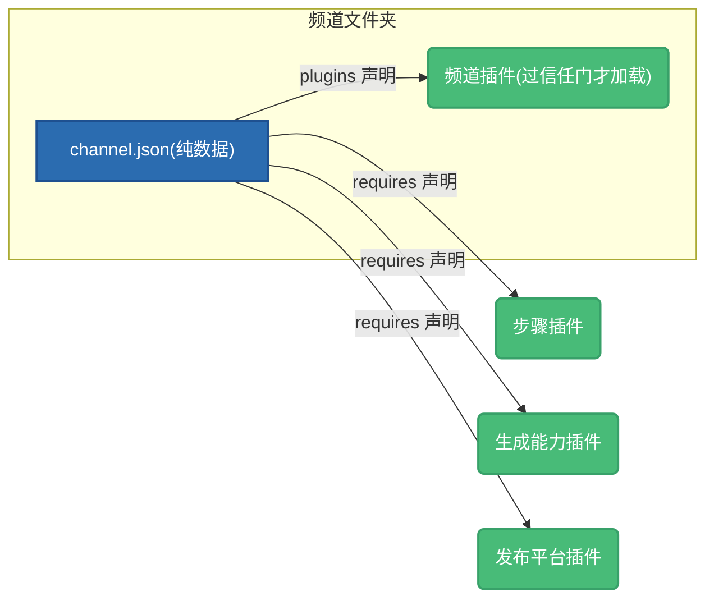

# 频道卡是什么

:::tip 用 AI 助手开发?
装上[官方 agent skills](/docs/guide/ecosystem/develop),对你的 Claude Code / Codex 说「帮我做一个 Channek 频道」,它会先问清你的创作流程,再替你写出能过校验的频道卡——本册的规矩它都懂。
:::

**频道卡是一个频道创作系统的完整描述符。** 它回答的不是「这个频道长什么样」一个问题,而是四个:

| 层 | 回答什么 | 例子 |
|---|---|---|
| **流程** | 内容怎么一步步做出来 | 选题 → 写稿 → 配音 → 剪辑 → 发布,每步用哪个能力、什么配置 |
| **参数** | 这个频道是谁、产出长什么样、听起来什么样 | 赛道与人设、品牌 token、画幅、音色、字幕样式——写在 `config` 里,字段由你或插件声明 |
| **呈现** | 打开这个频道时界面长什么样 | 启用哪些功能区、默认落在哪个区 |
| **依赖** | 跑这套流程需要什么 | 要哪些插件、哪些能力、哪几把密钥 |

在 Channek 里,**频道 = 一个文件夹 + 根目录一份频道卡 `channel.json`**:文件夹根上有这份卡,它就是频道。文件只能叫这个名、只能放在频道根;除此之外,文件夹里怎么摆完全由你定。推荐摆成两半:

```
acme.talkfast/
├── channel.json    ← 频道卡
├── sop/            ← 怎么做(菜谱):流程说明、skill、提示词、脚本、质检教训——分享时带走
└── work/           ← 做出来的东西(菜):每一期、选题、复盘——分享时不带
```

同一副软件骨架,换一份卡就长成另一套工作方式——这正是卡存在的意义:**把「这类创作怎么做」变成一件可复制、可分发、可售卖的资产。** 分享时拷走的是做法,不是你的作品:收卡人拿到 `sop/` 那一半和这张卡,开出来的是他自己的频道。

## 卡是纯数据,永远不含代码

`channel.json` 本身是**纯声明数据**:

- 卡里没有安装脚本、没有钩子、没有可执行文件——读一张卡**不会执行任何代码**;
- 干活的代码住在**插件**里,卡只声明「我需要哪个插件、哪类能力」:多个频道共用的全局插件写进 `requires`,只给这个频道用的**频道插件**住在频道文件夹里、由卡的 `plugins` 点名——频道被你信任之前,它们一个都不加载;
- 一个恰当的类比是 `docker-compose.yml`:它编排引用镜像,自身不含镜像。



:::note
「纯数据」保证的是**卡本身零代码执行风险**,不等于零影响——卡里的流程声明会驱动自动化步骤、提示词会进入 AI 上下文。所以 Channek 对导入的卡有一套完整的体检与披露机制,见[导入向导](./distribution/import-experience.md)。
:::

## 这个模块怎么读

- **[核心概念](./concepts/three-layers.md)**——先弄清频道卡、插件、频道文件夹三者的关系,以及为什么这样切;
- **[写一张卡](./authoring/card-json.md)**——`channel.json` 每一段怎么写,从结构总览到逐段细讲;
- **[打包与分发](./distribution/portability.md)**——可移植红线、上架物料、`.channel` 打包与收卡人看到的导入体验。

如果你还没写过插件、只想为自己的频道定制一套流程与风格,读完本模块就够了;要自己实现流程步骤或生成能力,再去「插件开发」模块。
