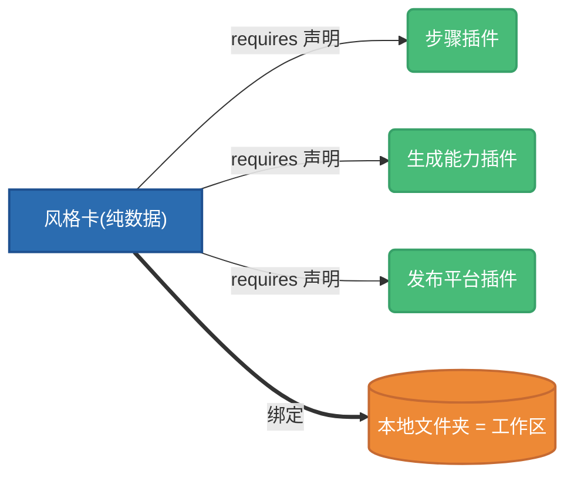

# 风格卡是什么

:::tip 用 AI 助手开发?
装上[官方 agent skills](/docs/guide/ecosystem/develop),对你的 Claude Code / Codex 说「帮我写一张风格卡」,它会先问清你的创作流程,再替你写出能过校验的卡——本册的规矩它都懂。
:::

**风格卡(Style Card)是一个频道创作系统的完整描述符。** 它回答的不是「这个频道长什么样」一个问题,而是四个:

| 层 | 回答什么 | 例子 |
|---|---|---|
| **流程** | 内容怎么一步步做出来 | 选题 → 写稿 → 配音 → 剪辑 → 发布,每步用哪个能力、什么配置 |
| **风格** | 产出长什么样、听起来什么样 | 品牌色板、画风锁、音色档、字幕样式、封面规则 |
| **呈现** | 打开这个频道时界面长什么样 | 启用哪些功能区、默认落在哪个区 |
| **依赖** | 跑这套流程需要什么 | 要哪些插件、哪些能力、哪几把密钥 |

在 Channek 里,**频道 = 工作区 × 卡**:一个本地文件夹(工作区)绑上一张卡,就成为一个频道。换一张卡,同一副软件骨架就长成另一套工作方式——这正是卡存在的意义:**把「这类创作怎么做」变成一件可复制、可分发、可售卖的资产。**

## 卡是纯数据,永远不含代码

卡的本体是一个 `card.json` 加一个资源目录(提示词、品牌素材、文档)。它是**纯声明数据**:

- 导入一张卡**不会执行任何代码**——没有安装脚本、没有钩子、没有可执行文件;
- 干活的代码住在**插件**里,卡只通过 `requires` 段声明「我需要哪个插件、哪类能力」;
- 一个恰当的类比是 `docker-compose.yml`:它编排引用镜像,自身不含镜像。

:::note
「纯数据」保证的是**零代码执行风险**,不等于零影响——卡里的流程声明会驱动自动化步骤、提示词会进入 AI 上下文。所以 Channek 对导入的卡有一套完整的体检与披露机制,见[导入向导](./distribution/import-experience.md)。
:::

## 这个模块怎么读

- **[核心概念](./concepts/three-layers.md)**——先弄清卡、插件、工作区三者的关系,以及为什么这样切;
- **[写一张卡](./authoring/card-json.md)**——`card.json` 每一段怎么写,从结构总览到逐段细讲;
- **[打包与分发](./distribution/portability.md)**——可移植红线、上架物料、`.channekcard` 打包与收卡人看到的导入体验。

如果你还没写过插件、只想为自己的频道定制一套流程与风格,读完本模块就够了;要自己实现流程步骤或生成能力,再去「插件开发」模块。
